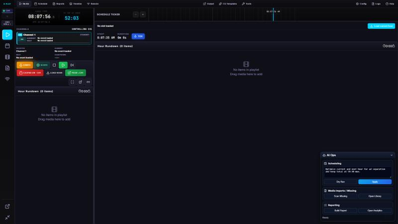

# PLAY PLAY

PLAY PLAY is a C++/Qt 6 broadcast playout automation system for a small local TV station: an hour-slot scheduler,
frame-clocked channel engines, a graphics (CG) pack, generated spots, an ATSC multiplexer and a web dashboard, driven
from a native operator app.

> **Status.** Windows only (x64), pre-1.0, and in use at a single small station. Interfaces, REST routes, settings keys
> and the database schema may change without notice. There is no CI and there are no published releases yet.
> **Licence.** None has been added yet, which means all rights are reserved until the owner adds one. See
> [Licence](#licence) and [Trademarks](#trademarks).



*The screenshot shows the original Electron-based operator UI (kept for reference in [reference/](reference/README.md)),
which the native QML app in `Play_Play_Native/` re-creates.*

## Features

- **Supervisor plus per-channel engines.** A headless Supervisor owns the schedule database and the station state and
  starts one engine process per channel, so a crash in one channel does not take the others off air.
- **Hour-slot scheduler and as-run log.** Weekly grid, hour editor, query blocks, hour recipes and a format clock,
  filler and gap handling, as-run logging and branded reports
  ([docs/programming.md](docs/programming.md), [docs/reports.md](docs/reports.md)).
- **Engine and outputs.** FFmpeg-based decode, a CPU or Direct3D 11 compositor, and outputs to NDI, DekTec ASI/SDI and
  Blackmagic DeckLink cards (each only when its SDK is available at build time) and encoded UDP/SRT streams.
- **Graphics.** An HTML/CSS template pack in `web/cg/` rendered by the engine through a headless Chromium-family
  browser, native lower-thirds and captions, a CG designer, and rule-driven overlays
  ([docs/overlays.md](docs/overlays.md), [docs/cg-designer.md](docs/cg-designer.md),
  [docs/cg-captions.md](docs/cg-captions.md)).
- **Generated spots.** Recipes that turn feeds, forecasts and listings into short branded spots with synthesized
  narration and music, plus a guided spot studio ([docs/spots.md](docs/spots.md),
  [docs/spot-studio.md](docs/spot-studio.md)).
- **ATSC multiplexer.** Services, PSIP tables and SCTE-35 cues, with DekTec ASI output
  ([docs/mux.md](docs/mux.md)).
- **MasterPlay import/export.** Reads and writes MasterPlay-style `.IN` playlists. PLAY PLAY is not affiliated with
  MasterPlay.
- **On Air switcher.** Program and preview monitors, an input bus (NDI, ONVIF/PTZ cameras), CUT and AUTO takes
  ([docs/onair-switcher.md](docs/onair-switcher.md)).
- **Remote nodes and failover.** Sessions, remote nodes and primary/backup failover
  ([docs/redundancy.md](docs/redundancy.md), [docs/render-nodes.md](docs/render-nodes.md),
  [docs/star-nodes.md](docs/star-nodes.md)).
- **Two UIs over one API.** A web dashboard served by the Supervisor on port 7700 and the native QML app.
- **Optional.** libobs scenes as a live-input layer ([docs/libobs.md](docs/libobs.md)), a reporter go-live feed
  ([docs/reporter-feed.md](docs/reporter-feed.md)), transcription, publishing to Facebook Live and other rails
  ([docs/publisher.md](docs/publisher.md)).

Most of these were written for one station's workflow and are documented in [docs/](docs/README.md); expect local
assumptions (a Virginia/North Carolina market, specific data sources) in the defaults.

## Architecture

| Process | What it is |
|---|---|
| `PlayPlay.exe` | The operator app (Qt Quick/QML, `Play_Play_Native/`). Starts a Supervisor if none is running, or attaches to one. |
| `PlayPlaySupervisor.exe` | Headless automation host. Schedule database, scheduler, media library, spot generator, mux manager, REST on port **7700**, WebSocket on port **7701**, and the web dashboard (`web/`). Can run as a Windows service. |
| `PlayPlayChannelEngine.exe` | One per channel, spawned and supervised by the Supervisor: decode, composite, output. Talks to the Supervisor over a local IPC pipe. |
| `web/` | The web dashboard (plain JavaScript) and the CG template pack (`web/cg/`). |
| `tools/` | Separate helper programs and libraries, mostly built only by name (see the layout table). |

The operator app and the dashboard are both clients of the Supervisor's REST and WebSocket API; nothing on air depends
on either UI being open.

## Prerequisites

- Windows 10/11 x64.
- Visual Studio 2022 Build Tools (MSVC). The sources use MSVC-specific compiler flags.
- CMake 3.21 or newer and Ninja.
- Qt 6.9 (Core, Gui, Widgets, Network, Sql, Qml, Quick, QuickControls2, WebSockets, Concurrent, Test). The build tree is
  staged assuming the conda-forge Qt layout (plugins under `lib/qt6/plugins`, QML modules under `lib/qt6/qml`). With a
  different Qt layout, adjust the staging step in `CMakeLists.txt`.
- FFmpeg 9 shared development build (headers, import libraries, DLLs). The project is developed against a GPL build
  (libx264, SRT) such as the BtbN `win64-gpl-shared` package.
- Optional, user-installed under their own licences: NDI SDK 6, DekTec DTAPI, Blackmagic DeckLink SDK (headers/IDL), a
  libobs install, TSDuck, Python 3 with the packages used by the spot and transcription scripts, Node.js for the
  Kokoro narration helper. None of these SDKs are included in this repository.

SDK locations are CMake cache variables. The defaults in `cmake/Deps.cmake` are typical install paths on one machine,
so pass your own:

| Variable | Meaning |
|---|---|
| `PLAYPLAY_QT_ROOT` | Qt prefix (contains `lib/cmake/Qt6`). Defaults to `%CONDA_PREFIX%\Library` when a conda environment is active. |
| `PLAYPLAY_FFMPEG_ROOT` | FFmpeg prefix (`include/`, `lib/`, `bin/`). Required. |
| `PLAYPLAY_NDI_ROOT`, `PLAYPLAY_DEKTEC_ROOT`, `PLAYPLAY_DECKLINK_ROOT` | SDK roots. A missing SDK is skipped, not an error. |
| `PLAYPLAY_LIBOBS_ROOT` | libobs install prefix, used only with `PLAYPLAY_WITH_LIBOBS=ON`. |

Switches (all `-D<NAME>=ON|OFF`):

| Switch | Default | Effect |
|---|---|---|
| `PLAYPLAY_WITH_NDI`, `PLAYPLAY_WITH_DEKTEC`, `PLAYPLAY_WITH_DECKLINK` | ON | Build that output when its SDK is found. |
| `PLAYPLAY_WITH_LIBOBS` | OFF | Build the libobs live-input source. libobs is GPL-licensed, so a binary built with this ON is a GPL combined work. |
| `PLAYPLAY_BUILD_TESTS` | ON | Build the Qt Test suite in `tests/`. |
| `PLAYPLAY_DEV_TREE` | OFF | Make the binaries refuse the default Supervisor identity (ports 7700/7701, IPC name, data directory), so a development build cannot collide with a Supervisor already running on the same PC. |
| `PLAYPLAY_BUILD_MASTERPLAY`, `PLAYPLAY_BUILD_NOWPLAYING`, `PLAYPLAY_BUILD_REPORTERFEED`, `PLAYPLAY_BUILD_STUDIO` | by build directory name | Optional feature lanes. Each defaults ON only when the build directory is named `build-seg` or `build-lanes` (MasterPlay also `build-mp`, Now Playing `build-np`, Studio `build-studio`) and OFF otherwise. Pass the switch explicitly to override. |
| `PLAYPLAY_WITH_ANFS`, `PLAYPLAY_ANFS_TESTS` | ON except in `<source>/build`; OFF | The AN-FS file-mesh peer (`tools/anfs`). |
| `PLAYPLAY_WITH_LEGACY_CLIENTS` | ON | Legacy ffplayout and OBS WebSocket clients. |

The Studio lane needs generated data files (`tools/studio/data/*.json`) that are not part of this repository. Without
them the lane is skipped during configure and `PlayPlayStudio` is not built.

## Build

From a Visual Studio x64 developer prompt (if the MSVC environment is not already set up, `scripts\build.ps1` looks for
the dev shell at a fixed path, `C:\BuildTools`, which you may need to edit; `run-dev.ps1`, `package.ps1` and
`start-extras.ps1` likewise carry a default Qt path of one machine, so pass `-QtRoot`; `start-extras.ps1` also reads `PLAYPLAY_QT_ROOT`):

```
pwsh scripts\build.ps1 -QtRoot <qt-prefix>
```

`scripts\build.ps1` configures a Ninja Release build in `build\`, builds, runs `ctest` (skip with `-NoTests`) and
reports where the executables are. Equivalent by hand:

```
cmake -S . -B build -G Ninja -DCMAKE_BUILD_TYPE=Release -DPLAYPLAY_QT_ROOT=<qt-prefix> -DPLAYPLAY_FFMPEG_ROOT=<ffmpeg-prefix>
cmake --build build --parallel
ctest --test-dir build --output-on-failure
```

Targets marked `EXCLUDE_FROM_ALL` (`PlayPlayMux`, `PlayPlayMediaTool`, `PlayPlaySpeech`, `PlayPlaySpotRender`,
`PlayPlayWatchdog`, `PlayPlayStudio`, `anfs`, many tests) are built by name:
`cmake --build build --target PlayPlayMux`.

This copy of the repository is a fresh export; some tests need optional data, hardware or network access and may fail or
skip on a clean machine.

`scripts\package.ps1` assembles a distributable folder and, if Inno Setup is installed, a setup program from
`installer/playplay.iss`. **Do not publish such a package without reading [THIRD_PARTY_NOTICES.md](THIRD_PARTY_NOTICES.md):**
it bundles a GPL FFmpeg build, Qt (LGPL) and, if present, libobs (GPL) and the NDI runtime, whose licence texts and a
source offer you would have to ship.

## Run

```
pwsh scripts\run-dev.ps1
```

starts the Supervisor and then the operator app from `build\`. Open the dashboard at <http://127.0.0.1:7700/>.
`Start-PlayPlay-Extras.cmd` starts a separate test Supervisor and app (own data directory, ports 17897-17899, engines
not started automatically), which is the safer way to try things on a machine that also runs a station.

Started by the operator app, the Supervisor keeps its data under `%APPDATA%\PlayPlay\PLAY PLAY\supervisor`. A Supervisor
started by hand defaults to `.\data`; use `--data-dir`, `--rest-port` and `--ws-port` to change that. Settings are
stored in the Supervisor's database and changed through the API or either UI.

## Security

- The REST (7700) and WebSocket (7701) servers listen on **all network interfaces**. **If no `rest.token` setting is
  present, the API is unauthenticated for every client that can reach those ports**, including playout control and
  settings. Set a token (PUT `/api/v1/settings/rest.token` with body `{"value":"<secret>"}`, then restart the Supervisor,
  which reads it at startup; the dashboard and app then send it as a bearer token) before the machine is reachable from
  anywhere you do not trust, and do not open the ports to the internet. The installer's
  optional firewall task opens exactly these two ports.
- No credentials are shipped in this repository. API keys (for example the OpenRouter key used by the AI features) are
  entered in the settings or read from environment variables, and are stored in the Supervisor's database.
- `integration/ffplayoutapi.h` defaults to ffplayout's own `admin`/`admin`; that is upstream's default, intended for a
  loopback-only ffplayout instance.
- To report a vulnerability, see [SECURITY.md](SECURITY.md).

## Repository layout

| Path | Contents |
|---|---|
| `main.cpp`, `mainwindow.*`, `Play_Play_Native/` | The native operator app (QML UI, models, widgets). |
| `playout/supervisor/` | The Supervisor: scheduler, REST/WebSocket server, library, spots, mux, remote nodes. |
| `playout/engine/` | The channel engine: decode pipeline, compositor, outputs, encoder stage. |
| `playout/schedule/`, `playout/masterplay/` | Schedule model, recipes, flight plan; MasterPlay `.IN` import/export. |
| `playout/core/`, `core/`, `services/`, `utils/`, `database/`, `integration/` | Shared libraries: time, IPC, logging, settings, storage, integrations. |
| `web/` | Web dashboard and the CG template pack (`web/cg/`). |
| `tools/` | `anfs` (file-mesh peer), `studio` (spot studio engine), `mux` (TS/PSIP/SCTE-35 tool), `ppwatch` (watchdog), `mediatool`, `avkit`, `speech`, `spotrender`, `recompose`, `uispec`, `buttongallery`, `starnews-cg` (separate CG studio). |
| `scripts/` | Build, run and package scripts; the Python/Node helpers used by spots and transcription. |
| `filters/` | VapourSynth filter scripts. |
| `cmake/` | Dependency discovery and the optional-lane fragments. |
| `tests/` | Qt Test suite and test helpers. |
| `installer/` | Inno Setup script. |
| `docs/` | Feature documentation ([index](docs/README.md)). |
| `reference/electron-src/` | The original Electron/React app, kept as a non-buildable feature reference ([note](reference/README.md)). |
| `branding/`, `assets/` | Logos, icons, splash image and UI icon data. |

## Documentation

See [docs/README.md](docs/README.md) for an index. Good starting points: [docs/ROADMAP.md](docs/ROADMAP.md),
[docs/programming.md](docs/programming.md), [docs/onair-switcher.md](docs/onair-switcher.md) and
[docs/mux.md](docs/mux.md).

## Licence

No licence file has been added to this repository yet. Until the owner adds one, **all rights are reserved**: you may
read the code, but you have no permission to use, copy, modify or redistribute it. Third-party components keep their own
licences, listed in [THIRD_PARTY_NOTICES.md](THIRD_PARTY_NOTICES.md). Because the project links a GPL FFmpeg build and can
optionally link libobs (GPL-2.0-or-later), a GPL-family licence is the most coherent choice for binaries.

## Trademarks

"Star News", the Star News logo and the PLAY PLAY name and branding (`branding/`, `web/brand/`, the `starnews-*` images
under `web/cg/assets/` and `tools/starnews-cg/`) are excluded from any licence that covers the code and are not
licensed for reuse. MasterPlay, NDI, OBS, DekTec, Blackmagic Design and DeckLink, Intel, Twitter/X, YouTube and Google
are trademarks of their respective owners. This project is not affiliated with, endorsed by or sponsored by any of them;
names are used only to describe compatibility.

## About this code

Parts of this code, tests and documentation were written with the help of AI coding assistants (Claude Code), under the
direction and review of the owner.
